# Walkthrough: three suppliers between two environments

This is a real run between two Oracle Fusion development pods, recorded on 24 October 2026. In the screenshots they are labelled **us-dev2** (source) and **us-dev1** (target). Three suppliers were chosen because they differ between the pods:

| Supplier | Difference between the pods |
|---|---|
| **Supplier 104505** | Exists in the source pod only, with its address, site, contact and flexfields |
| **Supplier 3493** | Alternate name differs |
| **Supplier 73512** | DUNS number set in the source, empty in the target |

> The suppliers belong to a client, so their names, the business unit on their sites and the pod host name are blurred in the screenshots, and the two environments have been relabelled. Nothing else in the images was changed.

## Step 1: the hotfix board

The workspace shows every piece of work by type. Each row reads left to right: the module, the two discovery runs, the changeset, the pipeline run and where the work stands.

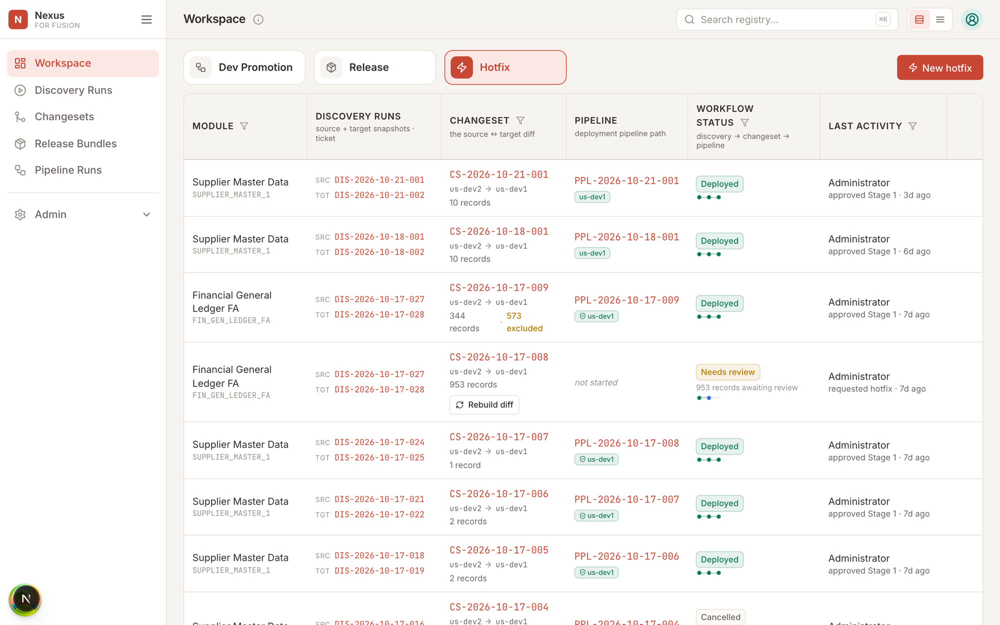

## Step 2: pick the records

**New hotfix** asks for a route, which fixes the source and target pair, and a module. For a master data module you search the source environment and tick the records to move. Only those records are read, on both sides, with everything under them.

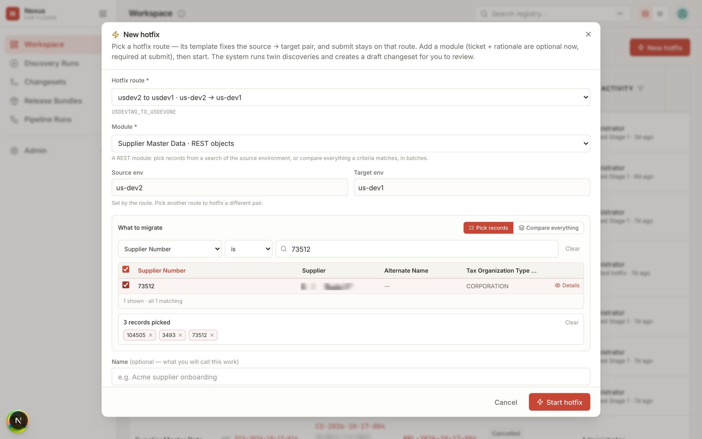

## Step 3: twin discovery

Nexus reads the picked records from both environments at the same time. For three suppliers this takes seconds; for forty thousand it takes about twenty minutes per environment.

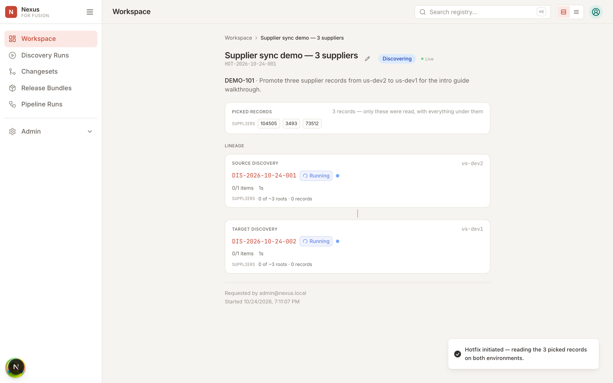

## Step 4: review the diff

The draft changeset lists every record that differs, grouped by object, with Added, Changed or Removed status. Selecting a record shows the field-level comparison: the value in the source that will be deployed next to the value the target holds now. Here the new supplier's full tree came back as 26 records.

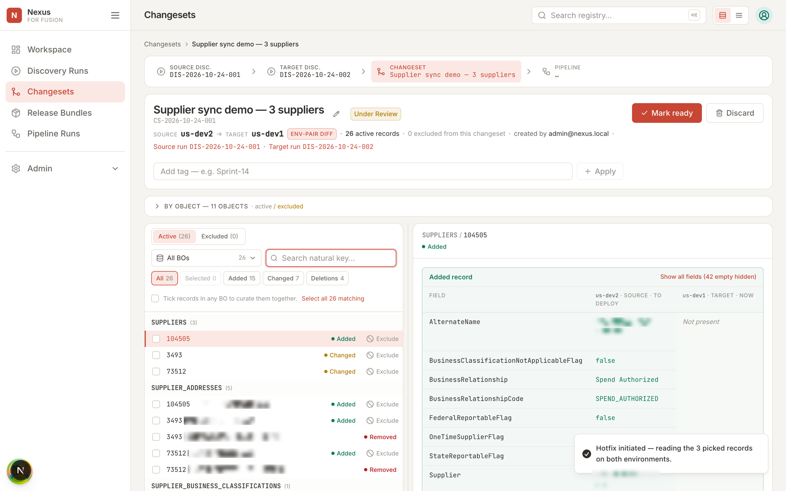

The reviewer kept the three supplier records and the new supplier's complete tree, and set aside the address and contact edits for a later change. The reason is stored on every excluded record. Supplier 3493 shows the one field that differs: its alternate name.

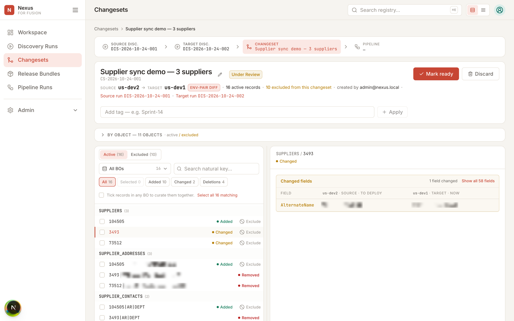

## Step 5: submit to the route

**Mark ready** locks the review. **Submit** shows the route and its single stage, asks for a ticket reference and a rationale, and the changeset enters the pipeline.

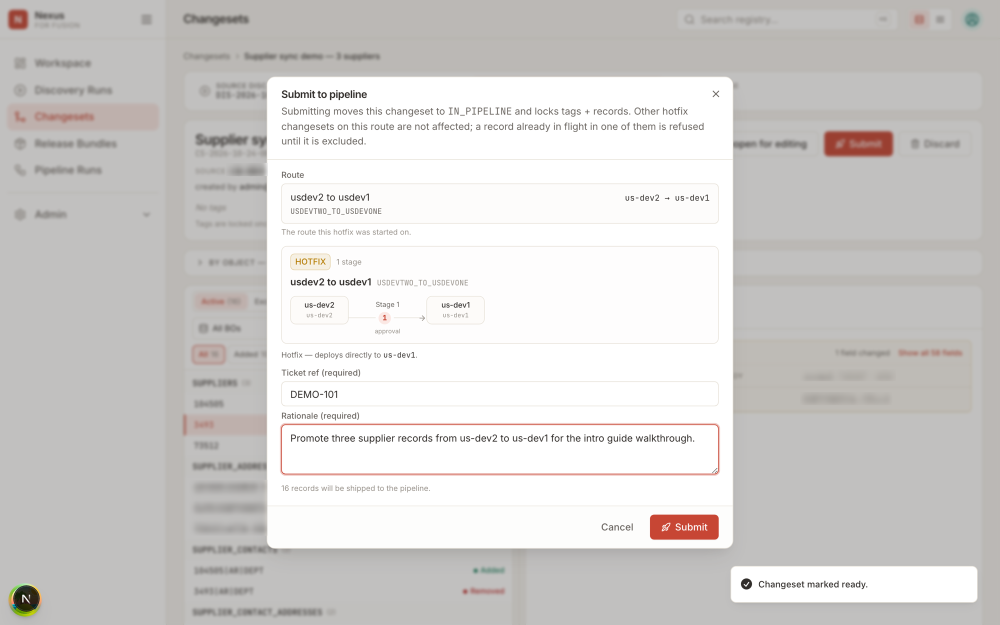

## Step 6: approval gate

The stage waits for an approver. The diff shown is against the target as Nexus read it for this run, not as it was at review time, so the approver sees what will actually change.

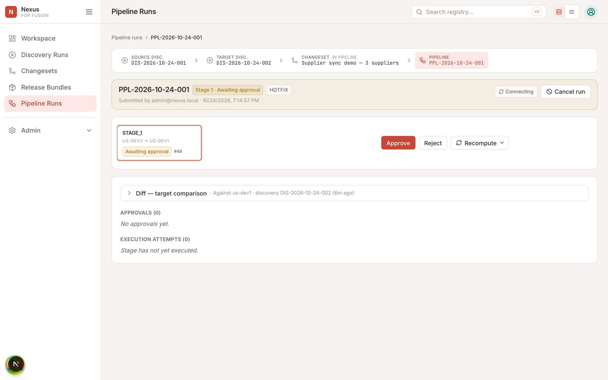

The approval carries a comment and is kept with the run.

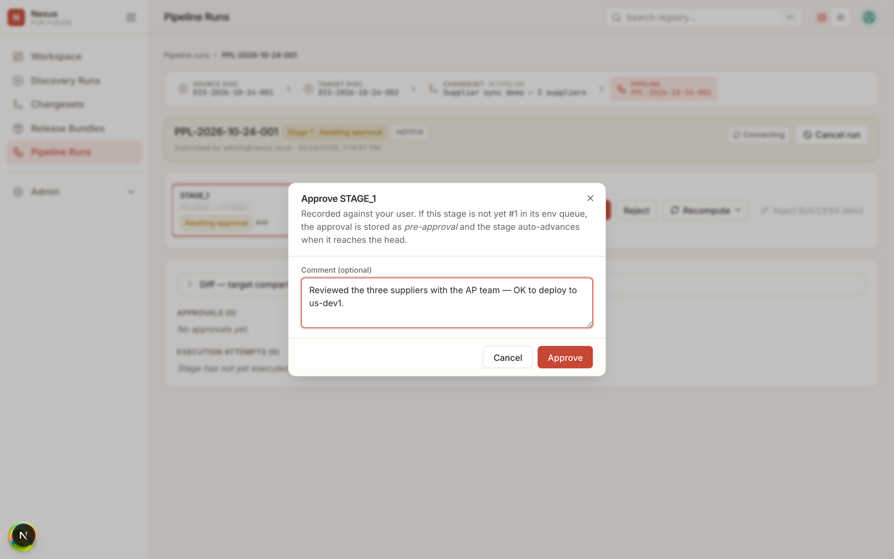

## Step 7: execution

After approval the stage executes. Each supplier tree is sent to Oracle as one request, parents first. The panel counts suppliers (a root record with everything under it) and lists every record with Oracle's own response. In this run 12 records were planned: 10 were written and 2 were already identical in the target, so Nexus left them alone. The three suppliers landed in 12 seconds.

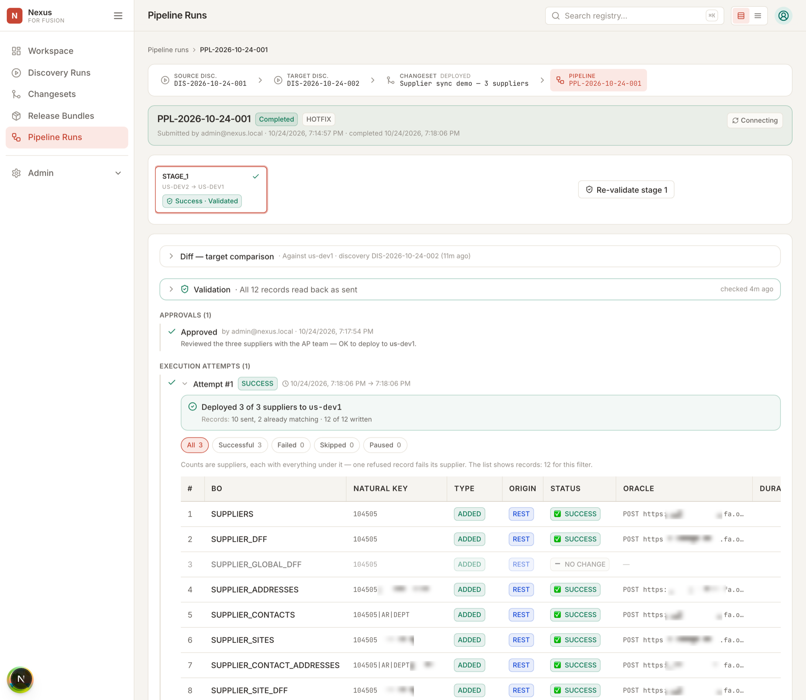

## Step 8: verify

**Validate** re-reads the target pod after the deployment and compares each record with what was sent. The stage shows **Success · Validated** and the panel lists the 12 records read back as sent, with the values side by side.

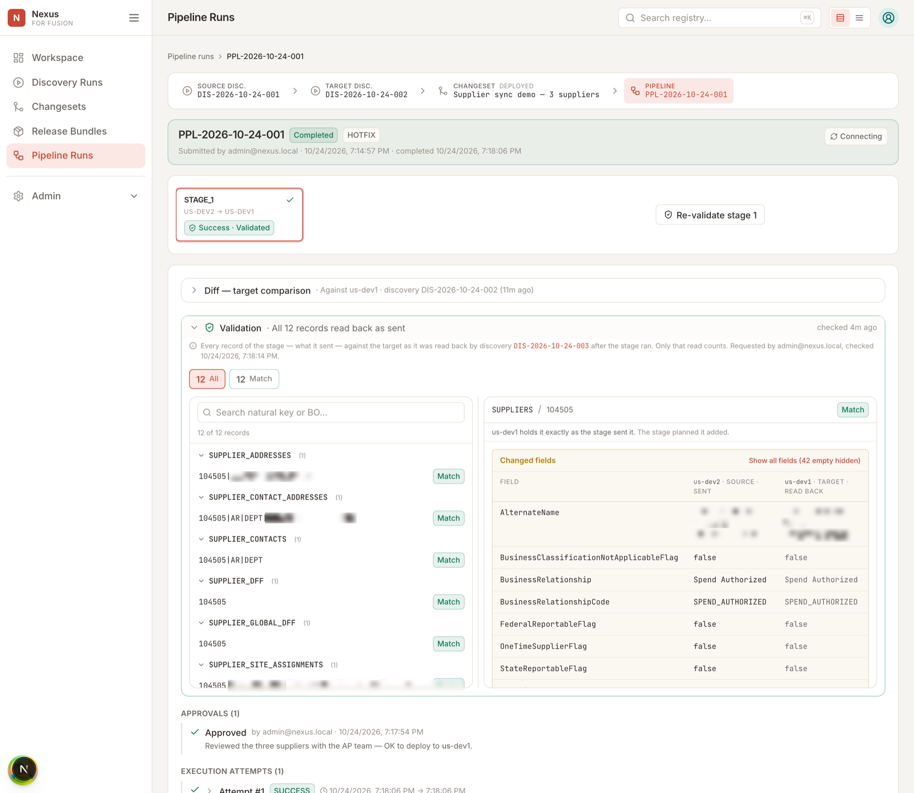

## Step 9: back on the board

The row now reads Deployed, with the discovery runs, the changeset (16 records, 10 excluded) and the pipeline run linked for anyone who needs to trace it later.

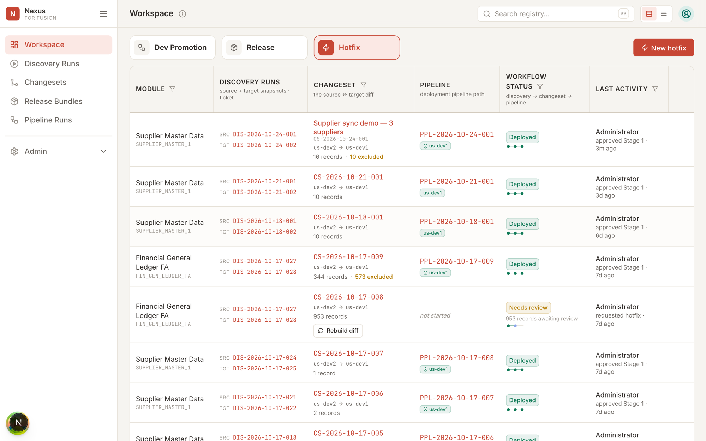

The whole walkthrough, from opening the dialog to the validated result, took about seven minutes of wall-clock time, most of it waiting for Oracle.

---

---

*Nexus is an independent product and is not affiliated with, endorsed by, or sponsored by Oracle. Oracle and Oracle Fusion Cloud are trademarks of Oracle Corporation and its affiliates.*
